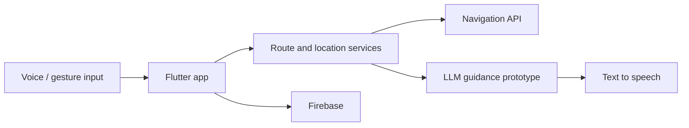

# NAVAI — Accessible AI Voice Navigation

시각장애인과 보행 약자를 위한 음성 중심 길안내 앱 연구·개발 프로젝트 (2025).

## Project scope

This repository preserves an intermediate personal development snapshot of a five-member team project. It is not the final team APK or a certified navigation product. Later team branches explored additional LLM guidance and Firestore route-step features.

## Engineering contributions

- Flutter application screens, voice-oriented interactions and feature integration.
- Firebase authentication, location sharing and route-related persistence.
- FastAPI-based language guidance prototype and TMAP integration experiments.
- User-centered requirements exploration through welfare-center interviews and feedback.

## Architecture (project-level)

## Repository status

The main and tmap branches reflect different stages. Some dependencies and configuration must be restored locally. Do not use real credentials or user location data in a public demo. A clean-clone build and real-world navigation safety have not been validated here. This prototype is not a substitute for established assistive navigation or safe mobility practices.

## Recognition

2025 nationwide software achievement-sharing forum — encouragement award (team project).

## Development notes

Flutter dependencies are declared in pubspec.yaml; Python server dependencies are under server/. Use an isolated virtual environment, provider credentials configured locally, and a test Firebase project. Do not commit environment files or generated dependency directories.

